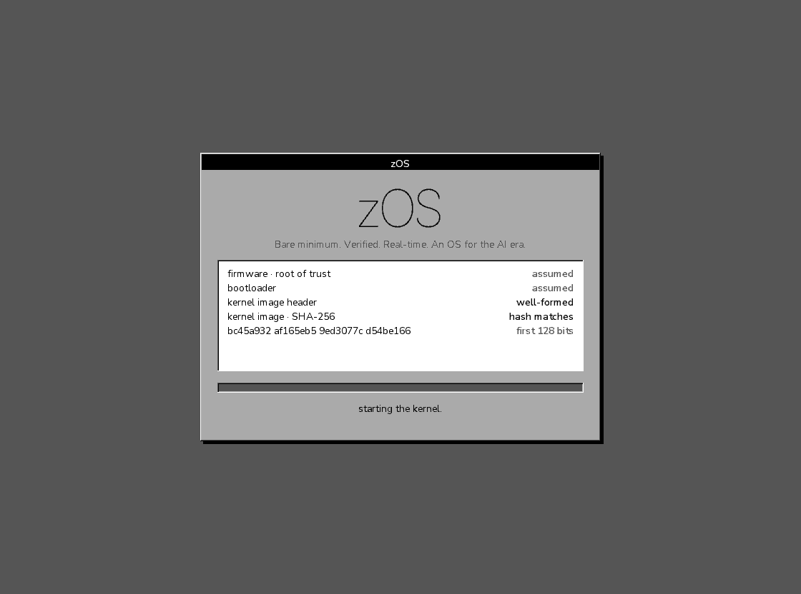
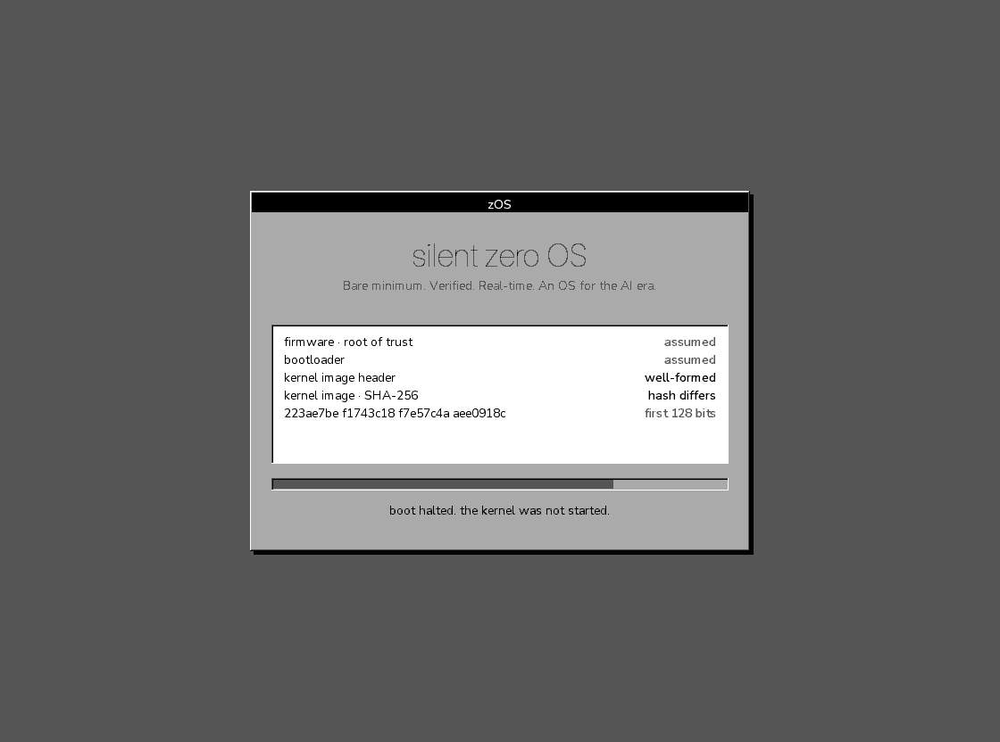
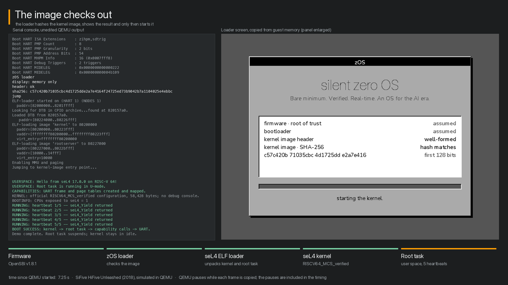

# zOS loader (prototype, QEMU RISC-V)

The first code that runs. It draws the boot screen, checks the kernel image against the hash in the image's header, shows the verdict, and starts the kernel only if the hash matches.




## What it checks, and what it does not

- **Checked:** that the image is the one its header describes. The header (magic, version, length, entry offset) and the payload are hashed together with SHA-256 and compared with the hash stored in the header. Flipping one bit anywhere in the header or the payload stops the boot; `test.py` does this six ways.
- **Not checked: who made the image.** A hash stored next to the image protects against accidents, not against someone who can rewrite both. Authenticity needs a signature verified against a key that lives in the loader. That is the next step; nothing here claims it, and the screen says only "hash matches".
- **Not done: finding the image on a storage device.** QEMU puts the image at `0x80400000` before the loader starts. A storage driver or a platform loader (U-Boot) is a separate module.
- **Not measured: the loader itself.** The screen says "assumed" for firmware and loader, because that is what it is.

## Image format

Little endian, 64-byte header, payload follows.

| offset | size | field |
|---|---|---|
| 0 | u32 | magic `zOSK` (0x4b534f7a) |
| 4 | u32 | version, 1 |
| 8 | u64 | payload length (at most 8 MiB) |
| 16 | u64 | entry point, offset from the image start (at least 64, inside the payload) |
| 24 | 32 | SHA-256 over header bytes 0..23 followed by the payload |
| 56 | 8 | reserved, zero |

Hashing the header fields as well as the payload means length, version and entry point cannot be changed without breaking the hash. The loader hashes the copy in memory that it then starts, not a copy on a medium.

## Modules

- `start.S`: entry, one hart, stack, clears `.bss`.
- `loader.c`: serial output, the display (fw_cfg and the ram framebuffer; on the HiFive model memory only), the checks, the jump. The display is the only platform-specific part: it obtains a framebuffer and converts the splash's four shades to its pixel format. Other platforms (a framebuffer from the device tree, UEFI, the Raspberry Pi's GPU firmware) add a module of their own behind the same two functions; the renderer does not change.
- `sha256.c`: SHA-256, incremental. The constants are computed by `gen_sha_tables.py` rather than typed, and the implementation is compared against Python's `hashlib` by `test_sha.c` for lengths around the block boundaries.
- `../splash/splash.c`: the renderer.
- `kernel_stub.c`, `kernel_start.S`, `kernel.ld`: a stand-in kernel that prints one line and stops QEMU, to prove that control was handed over.
- `mkimage.py`: wraps a flat binary in the header.

## In front of seL4, on the HiFive Unleashed model

`sel4-demo/` builds the official seL4 16.0.0 kernel in its verified MCS configuration, `RISCV64_MCS_verified`, whose platform is the HiFive Unleashed. `make hifive` builds this loader for QEMU's model of that board (`-DPLAT_HIFIVE`) and wraps seL4's ELF loader, with the kernel and the demo's root task inside it, as a zOS image. The chain is then: OpenSBI in machine mode, this loader in supervisor mode at `0x80200000`, the hash check, seL4's ELF loader at `0x82000000`, the kernel, the root task.



What is different on this machine:

- **No display.** QEMU's `sifive_u` has no display device; `ramfb`, `virtio-gpu` and `bochs-display` are all refused. The loader draws into memory at `0x81000000` all the same. `record_hifive.py` stops QEMU through its debugger each time the loader has finished a picture (the empty function `zos_frame_shown`), copies the framebuffer out of guest memory and lets it go on. The pictures in `recording/` are those copies; on a board with a display they would be the screen.
- **Five harts.** OpenSBI starts the loader on one hart; the loader does not park the others, because OpenSBI keeps them stopped until someone asks for them.
- **The SiFive UART** at `0x10010000` instead of the 16550 of `virt`.

`make test-hifive` boots the good image and the same image with one payload bit flipped and fails unless the good one reaches user space (five heartbeats from the root task) and the tampered one stops before seL4's ELF loader. `make video-hifive` renders both runs into `recording/loader-sel4-boot.mp4`: the serial console left, the loader's panel right, at the time they were recorded. QEMU stands still while a picture is copied, so those pauses are in the timing.

## Build and test

```
make              # needs clang with the RISC-V target and ld.lld
make test         # needs qemu-system-riscv64 and Pillow; writes a screenshot per case
make test-sha     # our SHA-256 against Python's hashlib
make hifive       # needs the xPack RISC-V GCC (riscv-none-elf-) and sel4-demo/build.sh run first
make test-hifive  # also needs riscv-none-elf-gdb; records recording/ and recording-tampered/
make video-hifive # needs ffmpeg and the macOS fonts Menlo and SF
```

With GCC instead of clang, `make CC="riscv-none-elf-gcc -march=rv64imac_zicsr_zifencei -mabi=lp64 -mcmodel=medany" LD="riscv-none-elf-ld -m elf64lriscv --gc-sections -nostdlib"` builds the same objects; the link for `virt` then also needs `libgcc.a` (the byte swaps of fw_cfg).

`make test` boots the loader in QEMU's `virt` machine with a ram framebuffer, once with the good image and five times with a flipped bit (payload, stored hash, entry point, length, magic). For each run it reads the serial verdict, takes a screenshot through the QEMU monitor and checks that the screenshot holds exactly the four grey shades. The good image must reach the kernel stub; every other image must not. Disabling the hash comparison in `loader.c` turns the four hash cases red, so the test can fail.

## Size

Text + data, `-Os`, `rv64imac`, measured with GCC 15.2 (xPack); the earlier clang figure, 8,896 bytes for `virt`, has not been measured again. The glyphs store only the pixels that are drawn and skip the background, which made the existing type almost 600 bytes smaller; that paid for the name "silent zero OS" in Inter Thin, which costs 118 bytes net.

| part | `virt` | HiFive |
|---|---|---|
| `start.S` | 52 | 50 |
| `loader.c` (display, checks, jump) | 1,841 | 1,481 |
| `sha256.c` including its constants | 1,000 | 1,000 |
| `splash.c` including its glyphs | 5,582 | 5,582 |
| whole loader | 7,809 | 7,333 |

For `virt` add the two byte-swap routines GCC takes from `libgcc.a`; they are in the whole-loader figure.

## Releases

`release.sh <version>` collects what a release carries: the loader and the boot image for the HiFive model, the video, the complete source of the seL4 commits inside the boot image (`git archive`), seL4's licence texts and ours, `THIRD-PARTY.md` and SHA-256 sums. The boot image contains GPL-2.0 code (seL4 kernel and ELF loader), so its source travels with it. Built twice in different directories on the same machine, the boot image came out bit for bit the same.
