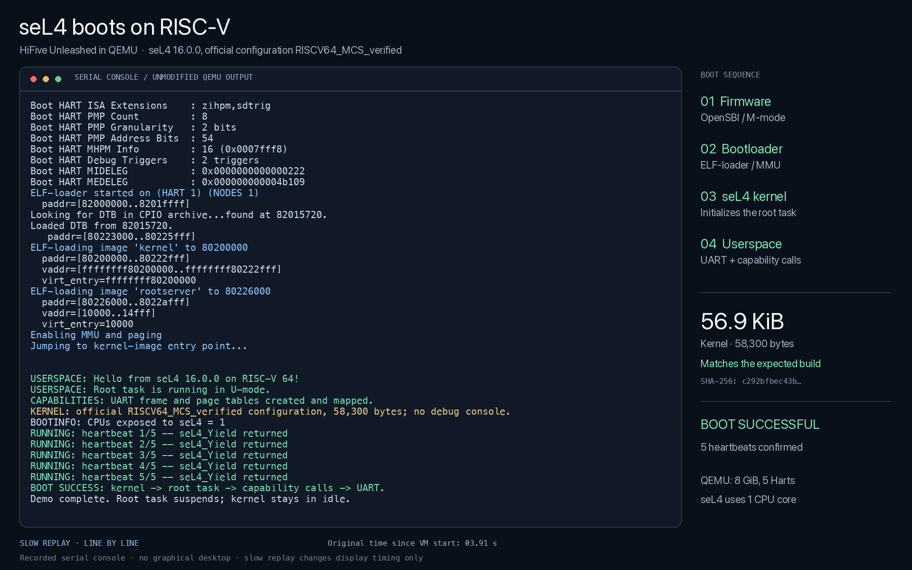

# seL4 boot demo (QEMU, RISC-V)

The official seL4 16.0.0 kernel, built with the unmodified preset `RISCV64_MCS_verified`, boots in QEMU's model of the HiFive Unleashed through OpenSBI and seL4's ELF loader to a small root task in user space. The root task maps a UART through capabilities and prints five heartbeats. Everything here can be rebuilt, and the build checks that the kernel is byte for byte the expected one.



## What it shows, and what it does not

- **Shown:** the kernel in the preset seL4 provides for its MCS verification on RISC-V boots and runs user code. All 22 settings of the preset are checked against the build's CMake cache; the kernel is 58,300 bytes, SHA-256 `c292bfbe…` (`expected.json`).
- **Not shown: a proof of this binary.** The proofs are about the C code. The compiler (GCC 15.2.0) is trusted; seL4 lists binary verification for 32-bit Arm only.
- **Not shown: hardware.** QEMU models the board. Firmware (OpenSBI) and the ELF loader run before the kernel and lie outside every proof.
- **Not shown: our loader.** This is seL4's own boot chain. Putting our loader between OpenSBI and the ELF loader is the next step.

## Files

- `fetch.sh`: the official sources at fixed commits into `deps/`: seL4 16.0.0 (`6e7c3b73`), seL4_tools (`6493e0c6`), util_libs (`ef49a397`). They are fetched, never copied into this repository.
- `build.sh`: configures with the preset, builds, and checks preset and kernel against `expected.json`. Three options lie outside the kernel and are explained in the script.
- `main.c`, `start.S`, `root.ld`: the root task.
- `CMakeLists.txt`, `cmake/cpio.cmake`, `make_cpio.py`: the build of the image; `make_cpio.py` replaces the `cpio` tool, which macOS lacks.
- `record.py`: boots the image and records the serial console with the time of each piece of output: `recording/boot-serial.log`, `recording/boot-events.json`.
- `render.py`: turns the recording into `recording/sel4-riscv-boot.mp4`, first in real time, then slowed down for reading and labelled as such. The page shows this video.

## Rebuild

Needs git, [uv](https://docs.astral.sh/uv/), `dtc`, QEMU with `qemu-system-riscv64`, ffmpeg, and the [xPack RISC-V GCC 15.2.0-1](https://github.com/xpack-dev-tools/riscv-none-elf-gcc-xpack/releases/tag/v15.2.0-1) (`riscv-none-elf-*`) on `PATH`. `render.py` uses the macOS fonts Menlo and SF.

```
sh fetch.sh
sh build.sh
python3 -I record.py
deps/venv/bin/python3 -I render.py
```

## Origin

The root task and the recording and rendering scripts were first written by the team with Codex for a build without MCS, and adapted here for the verified preset.
