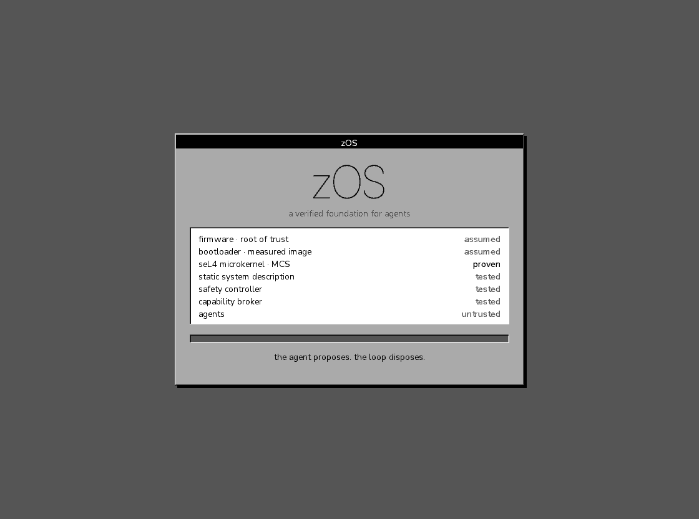

# zOS boot splash (prototype)

The first screen after power-on: a grey panel in four shades, bevelled edges, crisp grey-scale type, and the boot report of what was loaded and what we know about each part.



Freestanding C: no libc, no heap, no floating point. `zos_splash(fb, w, h, step)` draws one boot step into a framebuffer of one byte per pixel holding a shade 0..3. Size of `splash.c` including its glyphs (`clang -Os -ffreestanding`): 4,894 bytes for RISC-V (rv64gc), 8,182 bytes for AArch64.

- `gen_glyphs.py` rasterises the needed glyphs into 2-bit coverage, run-length coded, as `glyphs.h`. The typography is the site's: Inter only as Thin and only large (the wordmark), Nunito Sans for everything else. Both are licensed under the SIL Open Font License 1.1 (`../assets/fonts/`).
- `splash.c` draws panel, bevels, type and the boot report.
- `harness.c` renders every boot step to PGM files on an ordinary computer.

Build and render on a normal host:

```
python3 gen_glyphs.py        # needs Pillow and fontTools; only when the texts change
cc -O2 harness.c splash.c -o harness && ./harness
```

Two decisions are deliberate. The splash does not live in the bootloader, which belongs to the trusted base and must stay small; it runs as its own isolated component after the kernel, with access to the framebuffer only. And the report it shows is hard-coded in this prototype; in the real system it must come from the measured image and the system description.
